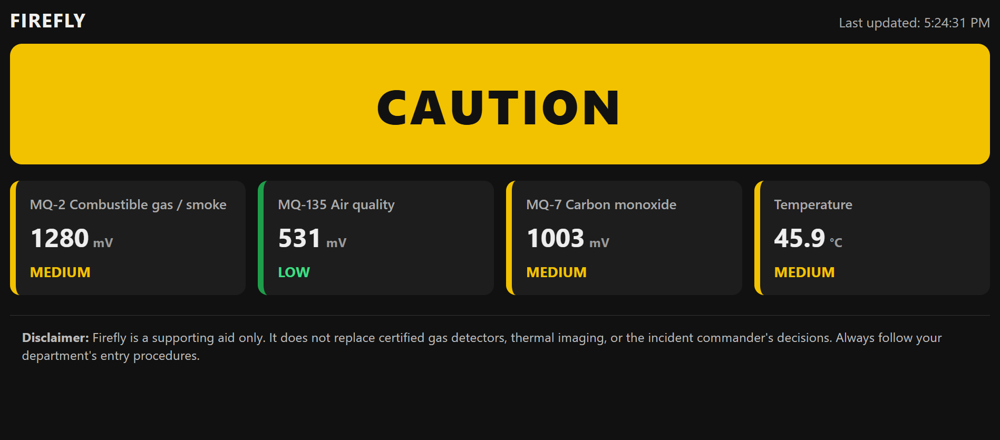
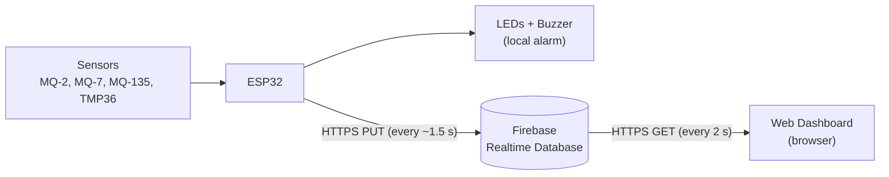
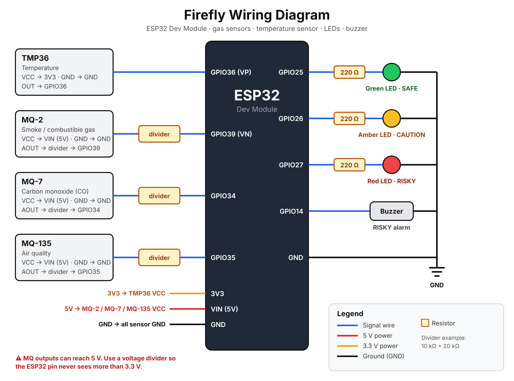
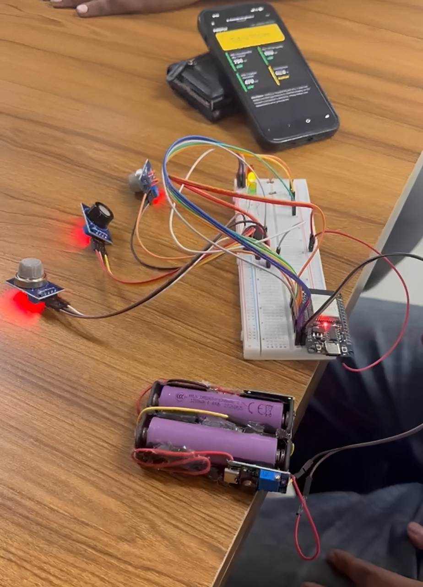

# 🔥 Firefly: Gas & Fire Safety Monitor

An IoT-based **gas, smoke and temperature safety monitor** built with an **ESP32**, **Firebase Realtime Database** and a responsive web dashboard.

The ESP32 reads gas sensors and a temperature sensor, raises a **local alarm** (LEDs + buzzer) immediately, and syncs live readings to a website that can be opened from any phone or PC.

**Live demo:** (https://altasin30-bot.github.io/firefly-safety-monitor/)



> ⚠️ **Disclaimer:** Firefly is a learning / supporting project. It does **not** replace certified gas detectors, thermal imaging, or professional safety procedures.

---

## Features

- Live **MQ-2 (smoke / combustible gas)**, **MQ-7 (carbon monoxide)**, **MQ-135 (air quality)** and **temperature** readings
- **Three-level status:** `SAFE`, `CAUTION`, `RISKY`, shown on the device LEDs and as a large banner on the dashboard
- **Safety logic runs on the ESP32** (not on the website):
  - Alarm works even when Wi-Fi or the internet is down
  - Buzzer sounds when status is `RISKY`
- **Offline detection:** the dashboard shows `DEVICE OFFLINE` if no new data arrives for 10 seconds
- Per-sensor level badges (`LOW`, `MEDIUM`, `HIGH`) with colour coding
- **Wi-Fi auto-reconnect** using `WiFiMulti`
- **No extra Arduino libraries:** uses the ESP32's built-in `WiFi` and `HTTPClient` with the Firebase REST API
- Works on mobile and desktop

---

## System architecture



The website and the ESP32 never talk directly. The ESP32 writes to one Firebase path and the dashboard reads from the same path. The alarm logic runs locally on the ESP32, so it keeps working without internet.

---

## Hardware

| Component | Purpose | ESP32 pin |
|---|---|---|
| ESP32 Dev Module | Microcontroller | n/a |
| TMP36 | Temperature | GPIO 36 (VP) |
| MQ-2 | Smoke / combustible gas | GPIO 39 (VN) |
| MQ-7 | Carbon monoxide (CO) | GPIO 34 |
| MQ-135 | Air quality | GPIO 35 |
| Green LED | SAFE | GPIO 25 |
| Amber LED | CAUTION | GPIO 26 |
| Red LED | RISKY | GPIO 27 |
| Buzzer | RISKY alarm | GPIO 14 |

> **Important:** MQ sensors are powered from **5 V**, and their analog output can go above the ESP32's **3.3 V** ADC limit. Use a **voltage divider** (two resistors) on each MQ output before connecting it to the ESP32.
>
> MQ sensors also need a **warm-up period** (a few minutes at least) before the readings become stable.
>
> Keep the TMP36 a few centimetres away from the MQ sensors. Their heaters get hot and will make the temperature read too high.

### Wiring



---

## Project structure

```
firefly-safety-monitor/
├── README.md
├── dashboard/
│   └── index.html
├── firmware/
│   └── firefly/
│       └── firefly.ino
└── images/
    ├── dashboard.png
    ├── wiring.png
    └── hardware.jpg
```

---

## How the status is decided

Every reading is first classified, then the overall status is computed.

| Sensor | MEDIUM | HIGH |
|---|---|---|
| Temperature | ≥ 40 °C | ≥ 55 °C |
| MQ-2 / MQ-7 / MQ-135 | > 1000 mV | > 2000 mV |

| Overall status | Rule | LED | Buzzer |
|---|---|---|---|
| **SAFE** | Nothing is MEDIUM or HIGH | 🟢 Green | Off |
| **CAUTION** | Temperature, MQ-2 or MQ-7 is MEDIUM | 🟡 Amber | Off |
| **RISKY** | Temperature, MQ-2 or MQ-7 is HIGH | 🔴 Red | On |

MQ-135 is shown on the dashboard with its own level, but it does not change the overall status. You can change all thresholds at the top of `firefly.ino`.

---

## Firebase database structure

```
firefly/
  latest/
    status      "SAFE" | "CAUTION" | "RISKY"
    ts          device uptime in milliseconds (changes every update)
    mq2         { mv, level }
    mq7         { mv, level }
    mq135       { mv, level }
    temp        { c, level }
```

Example:

```json
{
  "status": "SAFE",
  "ts": 123456,
  "mq2":   { "mv": 420, "level": "LOW" },
  "mq7":   { "mv": 380, "level": "LOW" },
  "mq135": { "mv": 510, "level": "LOW" },
  "temp":  { "c": 28.4, "level": "LOW" }
}
```

### Database rules (testing)

```json
{
  "rules": {
    "firefly": {
      ".read": true,
      ".write": true
    }
  }
}
```

> 🔒 These rules are open and are for **testing only**. Anyone who knows your database URL can write to `firefly/`. See [Limitations](#safety-and-limitations).

---

## Setup guide

### 1. Firebase

1. Create a project at https://console.firebase.google.com
2. **Build → Realtime Database → Create database** (start in test mode).
3. Copy the database URL, for example `https://YOUR-PROJECT-default-rtdb.region.firebasedatabase.app`
4. Open the **Rules** tab, paste the rules above and click **Publish**.

### 2. ESP32 firmware

1. Install the **ESP32 board package** in Arduino IDE.
2. Open `firmware/firefly/firefly.ino`.
3. Edit these lines at the top:

```cpp
const char* ssid1 = "YOUR_WIFI_NAME";
const char* pass1 = "YOUR_WIFI_PASSWORD";
const String FIREBASE_URL = "https://YOUR-PROJECT-default-rtdb.region.firebasedatabase.app";
```

4. Select **Tools → Board → ESP32 Dev Module** and the correct port, then upload.
5. Open the Serial Monitor at **115200 baud**. After each upload you should see `Firebase HTTP: 200`.

> 🔒 Never upload your real Wi-Fi password to GitHub. Keep `YOUR_WIFI_PASSWORD` in the public copy.

### 3. Dashboard

1. Open `dashboard/index.html` and set `FIREBASE_URL` to your database URL.
2. Open the file in a browser, or host it (see below).

### 4. Hosting the dashboard (free)

**GitHub Pages:** push the repo, then go to **Settings → Pages → Deploy from a branch → `main` / root**. The dashboard will be at
`https://YOUR-USERNAME.github.io/REPO-NAME/dashboard/`

**Alternatives:** Netlify Drop (drag and drop the `dashboard` folder) or Firebase Hosting.

---

## How it works

1. Every ~1.5 seconds the ESP32 reads all sensors in millivolts.
2. Each reading is classified as `LOW`, `MEDIUM` or `HIGH`, and the overall status is computed.
3. LEDs and the buzzer are updated immediately, with or without Wi-Fi.
4. If Wi-Fi is connected, the ESP32 sends the data to `firefly/latest` over HTTPS (`PUT`).
5. The dashboard reads `firefly/latest` every 2 seconds and updates the banner and cards.
6. If the `ts` value stops changing for 10 seconds, the dashboard shows `DEVICE OFFLINE`.

---

## Troubleshooting

| Problem | What to check |
|---|---|
| `Firebase HTTP: 401` | Database rules were not published |
| `Firebase HTTP: -1` | Wi-Fi not connected, or wrong Firebase URL |
| Dashboard says `NO CONNECTION` | Wrong `FIREBASE_URL` (must start with `https://`, no trailing `/`) |
| Dashboard says `DEVICE OFFLINE` | ESP32 is off or has no Wi-Fi |
| Temperature reads too high | TMP36 is too close to the MQ heaters, or its wiring is wrong (3.3 V / signal / GND) |
| False alarms right after power-on | MQ sensors are still warming up |

---

## Screenshots

| Dashboard | Hardware setup |
|---|---|
|  |  |

---

## Safety and limitations

- Firefly is an educational prototype and **not a certified safety device**.
- Gas readings are in **millivolts**, not ppm. The sensors are **not calibrated**, so values are approximate.
- MQ sensors need a warm-up time, and there is no warm-up delay in the code yet, so false alarms can happen right after power-on.
- The local alarm works without internet, but the dashboard needs Wi-Fi and Firebase.
- The database rules are open for testing. Add Firebase Authentication before any real use.
- The ESP32 uses `setInsecure()` for HTTPS, so it does not verify the server certificate.
- The dashboard does not send push notifications. Alerts are visible only while the page is open.
- This project was tested on the authors' own hardware setup only.

---

## Future improvements

- [ ] Sensor warm-up delay and alarm debounce (fewer false alarms)
- [ ] Include MQ-135 in the overall status
- [ ] History logging and live charts
- [ ] Telegram / push notifications
- [ ] Calibration and ppm conversion
- [ ] Firebase Authentication and secure rules
- [ ] Multiple devices on one dashboard
- [ ] OTA firmware updates and Wi-Fi provisioning

---

## Built with

ESP32 · Arduino IDE · Firebase Realtime Database (REST API) · HTML / CSS / JavaScript

---

## Author

**Your Name**
Student ID: your-id

Course: your course
University: your university

---

## License

MIT License
